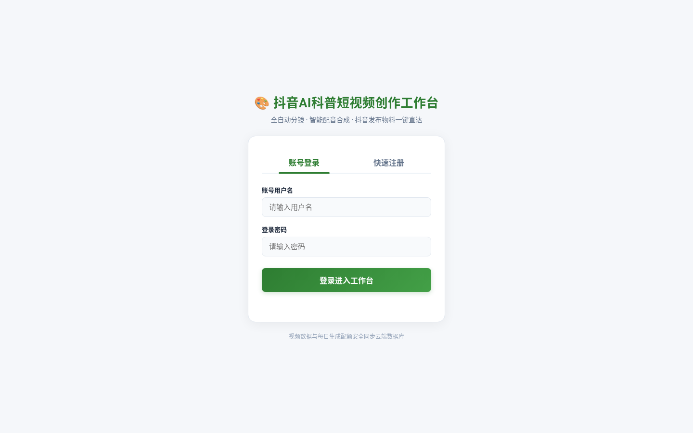
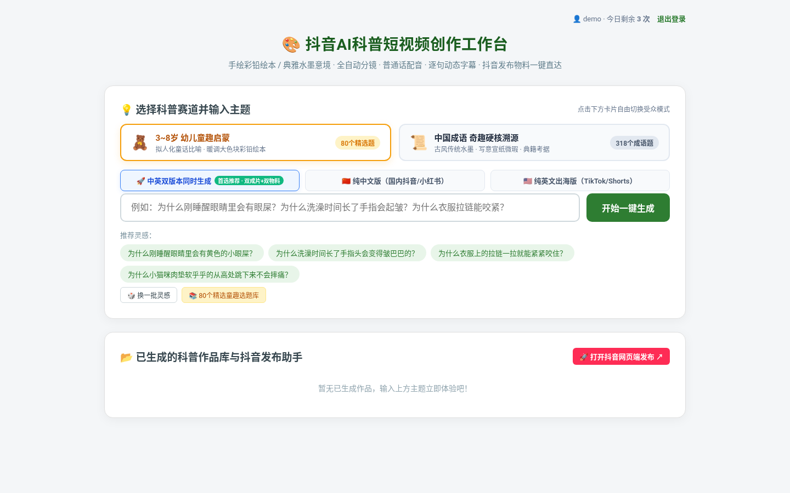
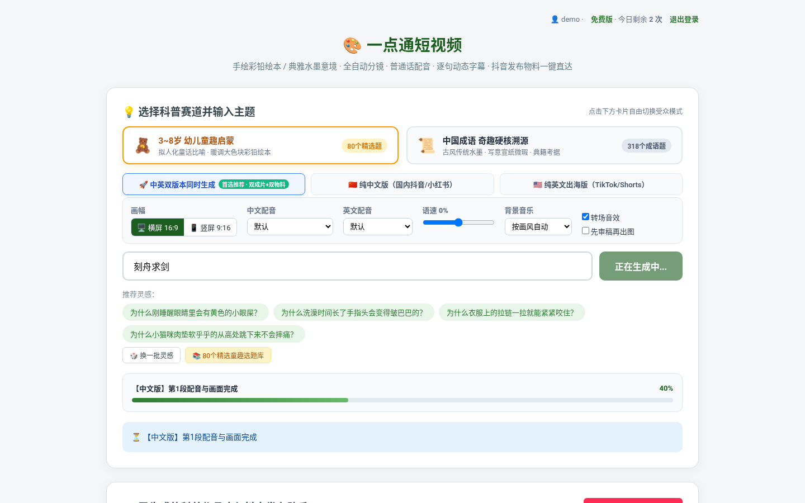
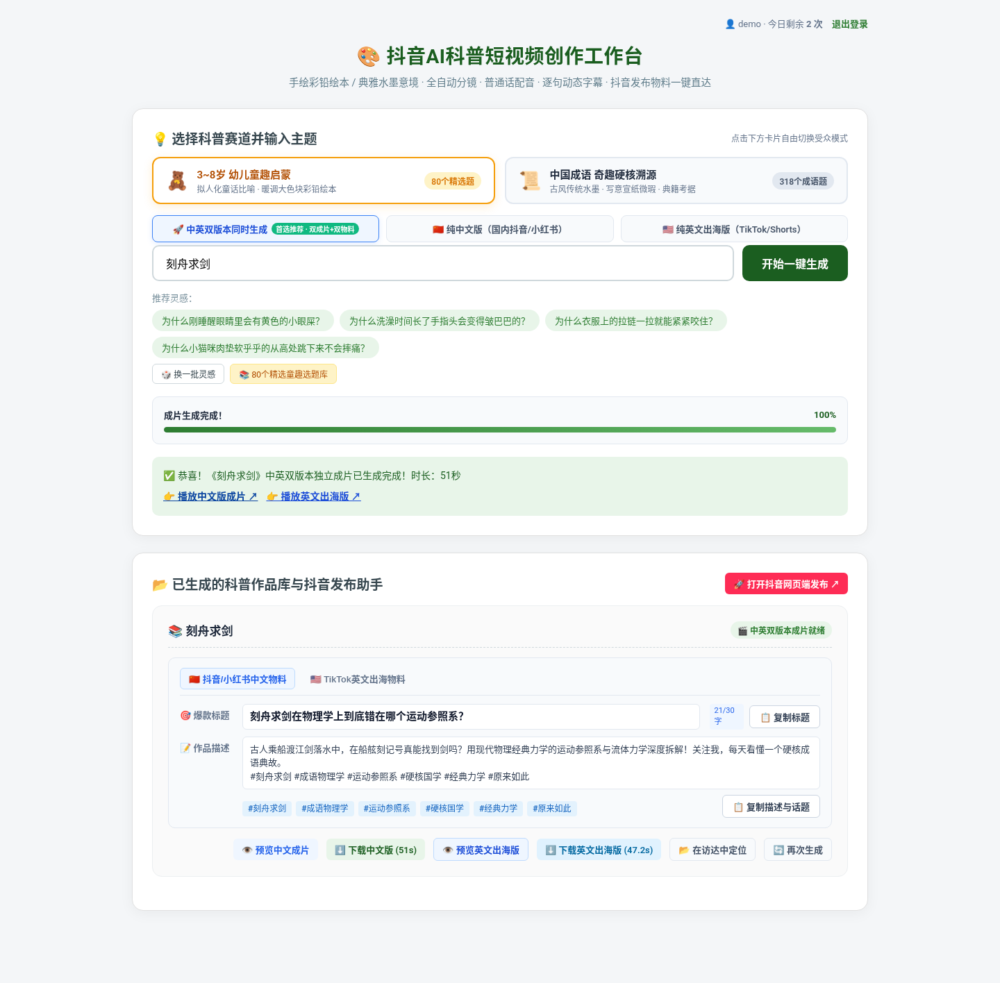
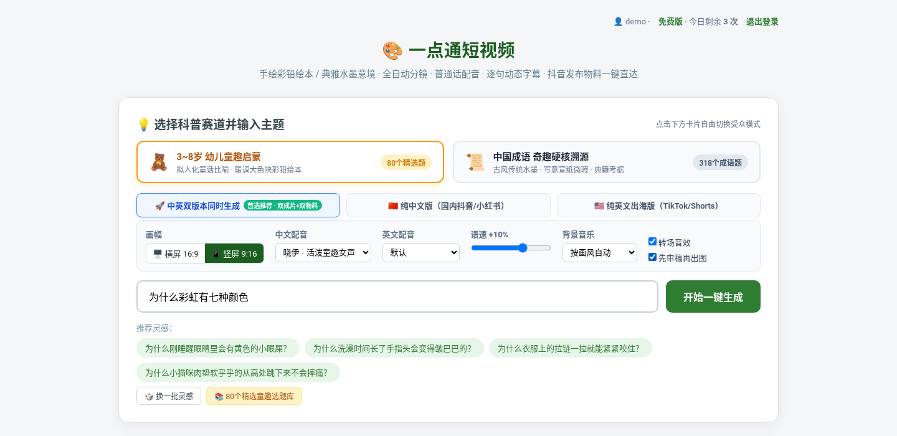
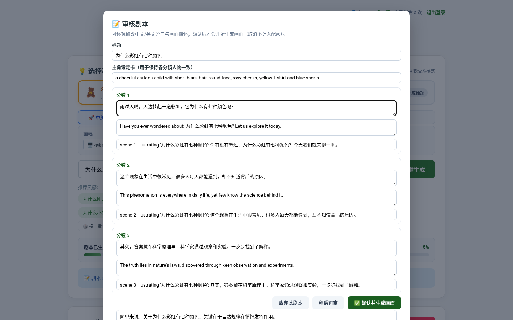
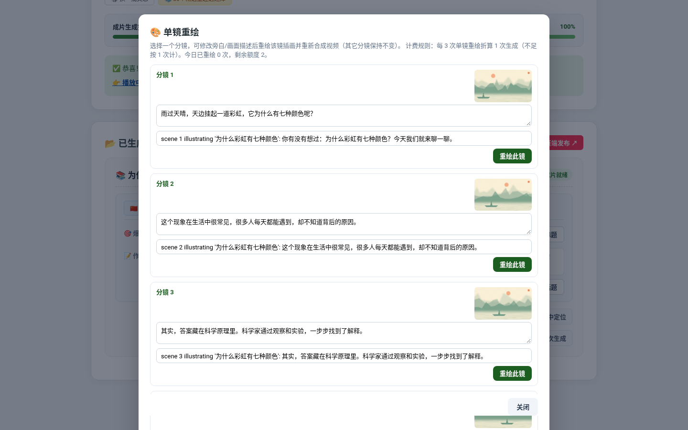
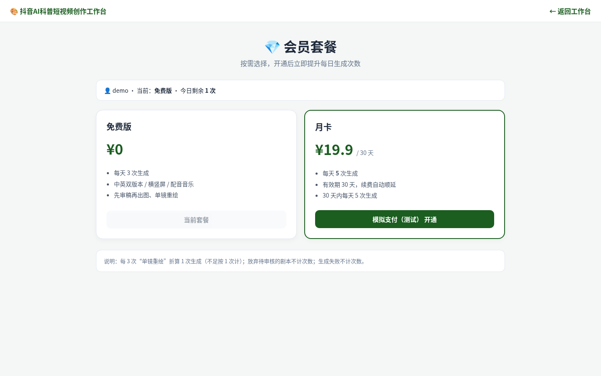
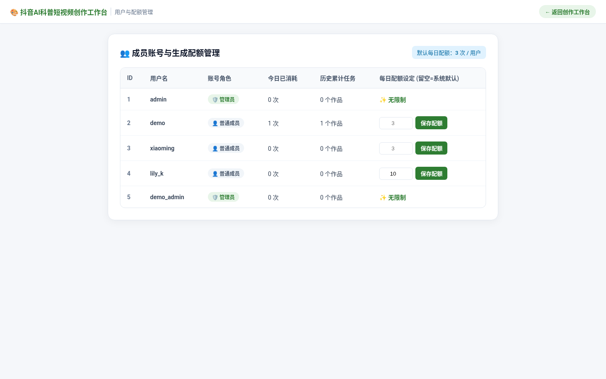

<div align="center">

# 🎬 科影工坊（KeyingStudio）

**输入一个科普问题或传统成语，一键生成约 1 分钟的高清画质配音字幕短视频，同时产出中文版 + 纯英文出海版以及适配国内全平台（抖音/微信视频号/快手/小红书）和海外 TikTok 的专属发布文案。**

[中文](#-项目简介) · [English](#-english) · [MIT License](LICENSE)


<sub>演示：内置成语《刻舟求剑》古风水墨成片（节选 10 秒）</sub>

</div>

---

## 📖 项目简介

面向自媒体创作者的短视频自动化工具。输入主题后，系统自动完成 **分镜剧本 → 插画 → 旁白配音 → Ken Burns 推镜 + 字幕合成**，输出 1280×720 H.264 MP4，并附带可直接复制的发布物料（爆款标题、作品描述、话题标签）。

两条内容赛道：

| 赛道 | 受众 | 画风 |
| --- | --- | --- |
| 🧸 幼儿童趣启蒙 | 3~8 岁 | 温馨彩铅 / 水彩儿童绘本 |
| 📜 中国成语奇趣溯源 | 少年 / 成人 | 古风写意水墨（山水烟雨、扁舟古人、宣纸质感） |

## ✨ 功能特性

- **全自动成片**：标题卡 + 5~6 个分镜，缓慢推镜动画，逐句烧录字幕，约 60 秒。
- **中英独立双版本**：一次生成插画，同时压制「纯中文版」和「英文出海版」（英文配音、英文字幕与标题卡）；也可只生成其中一种。再次生成同一主题会继承已有插画，保证两版画面一致。
- **全平台发布助手（国内全平台 + 海外 TikTok）**：自动生成适配抖音、微信视频号、快手、小红书与 TikTok 的爆款标题、描述和热门话题标签，一键复制；内置国内四大主流短视频平台创作者后台一键直达入口。
- **内置选题库**：幼儿 80 题、成语 300+ 题、科普 300 题，自动过滤已创作的选题。
- **可插拔 AI 服务**：剧本用 OpenAI 兼容大模型（默认阿里百炼 `qwen-plus`）；插画支持百炼 `qwen-image` / 万相 `wanx` / OpenAI 兼容接口；配音用通义 `qwen3-tts-flash`，失败自动回退到免费的 edge-tts（中文 `zh-CN-XiaoxiaoNeural`，英文 `en-US-JennyNeural`）。
- **生图风控自愈**：遇到内容审核拦截时，自动用大模型改写提示词并分级重试。
- **无 Key 也能试用**：内置《刻舟求剑》完整剧本与水墨插画；其它主题使用模板剧本 + 程序生成的占位插画，配音走 edge-tts。
- **账号与限额**：开放注册、bcrypt 密码哈希、HttpOnly 会话 Cookie；每人每日生成配额（默认 3 次）、每人同时 1 个任务；登录按 IP 限流防暴力破解。
- **管理后台**：管理员不限次数，可查看所有用户用量并单独调整每日配额。
- **任务持久化**：SQLite（WAL）保存用户与任务，重启不丢失，中断任务自动重新排队。
- **横屏 16:9 / 竖屏 9:16**：竖屏输出 1080×1920，字幕加大并上移到画面 3/4 处、按窄屏折行；横版插画放入竖屏时用模糊背景 + 完整原图居中，不裁掉主体。
- **背景音乐与音效**：内置「古风」「轻快」两类共 4 首 BGM（按画风自动选择，也可手动选择或关闭），旁白出现时自动压低音乐（sidechain ducking）；可选片头铃声与场景切换“嗖”声。所有音频均为程序合成，CC0，见 [assets/audio/LICENSE.md](assets/audio/LICENSE.md)。
- **先审稿再出图**：勾选后先只生成剧本，可逐镜修改中/英文旁白、画面描述、标题与主角设定，确认后才生成画面；放弃剧本不计次数。
- **单镜重绘**：成片后可单独重绘某一镜插画（可同时改旁白），其它镜头复用、配音按文本缓存，只重新合成视频。
- **多音色与语速**：edge-tts 中文 5 种（晓晓 温柔女声、云希 阳光男声、云健 浑厚男声、晓伊 童趣女声、云夏 童声男孩）、英文 4 种（Jenny、Guy、Aria、Ana 童声），语速 -30%～+30%。
- **角色一致性**：每个故事生成一张“主角设定卡”（外貌/服饰等固定特征，可在审稿时修改），拼接到每一镜的生图提示词；OpenAI 兼容接口下以第 1 镜为参考图调用 `/images/edits`；无 Key 占位模式下同一故事共用色板与人物剪影。
- **会员套餐与支付**：免费版每日 3 次，默认「月卡」¥19.9 / 30 天 / 每日 5 次；套餐可在配置文件或管理后台增删改，立即生效。订单表 + 可插拔支付接口（mock 测试、微信支付、支付宝骨架），管理员可手动开通会员。

## 🖼️ 界面截图

| 登录 / 注册 | 创作工作台 |
| :---: | :---: |
|  |  |
| **生成进度** | **成片与发布物料** |
|  |  |

| **生成选项（画幅/配音/语速/音乐）** | **先审稿再出图** |
|  |  |
| **单镜重绘** | **会员套餐页** |
|  |  |

<details><summary>管理员：用户、会员开通、套餐配置与订单</summary>


</details>

<sub>截图使用临时数据库和演示账号，在未配置任何 API Key 的回退模式下截取。</sub>

## 🎬 示例成片

《刻舟求剑》内置水墨版（中文配音 + 字幕）关键帧：

| | | |
| :---: | :---: | :---: |
|  |  |  |
|  |  | |

## 🚀 快速开始

### 1. 系统依赖

```bash
# Ubuntu / Debian
sudo apt update && sudo apt install -y python3 python3-venv ffmpeg fonts-noto-cjk
# macOS（需带 drawtext 滤镜的 ffmpeg）
brew install ffmpeg-full
```

### 2. 安装

```bash
git clone https://github.com/zhanglongAa520/yidiantong-video.git
cd yidiantong-video
python3 -m venv .venv && source .venv/bin/activate
pip install fastapi uvicorn requests edge-tts pillow bcrypt
```

### 3. 配置 `.env`（已在 `.gitignore` 中，切勿提交）

```env
ADMIN_USERNAME=admin
ADMIN_PASSWORD=请换成强密码
DAILY_QUOTA=3

# 以下均为可选；不填则进入免 Key 回退模式
LLM_BASE_URL=https://dashscope.aliyuncs.com/compatible-mode/v1
LLM_API_KEY=sk-xxxx
LLM_MODEL=qwen-plus
IMAGE_PROVIDER=qwen
IMAGE_API_KEY=sk-xxxx
TTS_PROVIDER=qwen
TTS_API_KEY=sk-xxxx

# 字幕字体：Linux 默认如下；macOS 可用 "/System/Library/Fonts/STHeiti Medium.ttc"
CJK_FONT=/usr/share/fonts/opentype/noto/NotoSerifCJK-Bold.ttc
```

### 4. 启动

```bash
chmod +x run.sh && ./run.sh      # 默认 http://localhost:8080
```

注册账号后即可开始创作；用 `ADMIN_USERNAME` 登录可访问 `/admin`。

## 💎 配额、计费与会员

**每日配额的计算**（按 `QUOTA_TZ` 自然日）：

- 管理员不限；管理员给某用户单独设置的配额优先；否则按有效会员套餐的每日次数（空 = 不限）；否则按免费版次数。
- 每成功提交 1 个视频计 1 次；**生成失败、放弃待审核剧本不计**。
- **单镜重绘：每 `REGEN_PER_QUOTA`（默认 3）次重绘折算 1 次生成，不足 3 次按 1 次计**（即当天第 1 次重绘占用 1 次额度，第 2、3 次不再额外扣，第 4 次再占 1 次）。重绘失败时原视频保留。
- 每人同时只能有 1 个进行中的任务（排队/生成中/待审核）。

**套餐配置**：优先级为 管理后台保存的配置（存 SQLite `settings` 表，立即生效）＞ `PLANS_FILE`（默认 `config/plans.json`，可参考 `config/plans.example.json`）＞ 内置默认（免费 `DAILY_QUOTA`=3 次/天；月卡 ¥19.9 / 30 天 / 5 次/天）。后台可“恢复默认”。续费同一套餐时到期时间自动顺延。

**支付**：`PAYMENT_PROVIDERS` 控制启用的支付方式（逗号分隔）。未启用任何方式时，定价页显示“在线支付暂未开通”，可由管理员在后台手动开通会员。

| 提供方 | 状态 | 说明 |
| --- | --- | --- |
| `mock` | ✅ 可用（仅测试） | 点击即“支付成功”。**切勿在公网启用**，否则任何人可免费开通 |
| `wechat` | ⚠️ 骨架 | `payments.WechatPayProvider`：APIv3 Native 下单与回调验签留有 TODO |
| `alipay` | ⚠️ 骨架 | `payments.AlipayProvider`：电脑网站支付/当面付签名与验签留有 TODO |

> **真实收款目前不可用。** 接入前需要：
> - **微信支付**：企业/个体工商户主体，微信支付商户号（`WECHAT_MCHID`）及关联的公众号/小程序/开放平台 AppID（`WECHAT_APPID`）、APIv3 密钥、商户 API 证书（序列号 + 私钥文件）、HTTPS 公网回调地址；
> - **支付宝**：支付宝开放平台应用（`ALIPAY_APP_ID`，签约“电脑网站支付”或“当面付”）、应用私钥与支付宝公钥（RSA2）、HTTPS 回调地址；可先用沙箱网关联调；
> - **网站本身**：在中国大陆服务器上提供网站服务需完成 **ICP 备案**，支付渠道审核通常要求网站已备案、页面展示服务内容/价格/联系方式/用户协议与隐私政策；经营性收费网站可能还需 **ICP 经营许可证**。具体以支付平台与主管部门要求为准。
> - 然后按 `payments.py` 中的 TODO 完成签名、下单与回调验签，回调地址为 `https://你的域名/api/pay/notify/wechat` 或 `/api/pay/notify/alipay`。

## ⚙️ 环境变量

| 变量 | 默认值 | 说明 |
| --- | --- | --- |
| **账号与系统** | | |
| `ADMIN_USERNAME` / `ADMIN_PASSWORD` | – | 启动时创建管理员（已存在则重置密码） |
| `DAILY_QUOTA` | `3` | 普通用户每日生成次数（失败任务不计） |
| `QUOTA_TZ` | `Asia/Shanghai` | 配额按该时区自然日重置 |
| `SESSION_DAYS` | `7` | 登录有效期（天） |
| `LOGIN_MAX_ATTEMPTS` / `LOGIN_WINDOW_SEC` | `10` / `900` | 同一 IP 在窗口内失败次数上限 |
| `COOKIE_SECURE` | `0` | HTTPS 部署时设为 `1` |
| `TRUST_PROXY` | `0` | 位于反向代理后设为 `1`（使用 `X-Forwarded-For` 识别 IP） |
| `DB_PATH` | `app.db` | SQLite 数据库路径 |
| `OUTPUT_DIR` | `output/` | 成片与中间文件目录 |
| `PORT` / `WORKERS` | `8080` / `1` | 端口 / 后台渲染线程数 |
| **剧本（大模型）** | | |
| `LLM_BASE_URL` / `LLM_API_KEY` | – | 任意 OpenAI 兼容 `/chat/completions` 接口 |
| `LLM_MODEL` | `qwen-plus` | 模型名称 |
| **插画** | | |
| `IMAGE_PROVIDER` | `qwen` | `qwen` / `wanx` / `openai` |
| `IMAGE_API_KEY` | – | 生图 Key；不填则使用占位插画 |
| `IMAGE_BASE_URL` | 视提供方 | 百炼默认 `https://dashscope.aliyuncs.com/api/v1`，OpenAI 默认 `https://api.openai.com/v1` |
| `IMAGE_MODEL` | 视提供方 | `qwen-image-2.0` / `wan2.2-t2i-flash` / `gpt-image-1` |
| `IMAGE_SIZE` | 视提供方 | 如 `1280*720`（百炼）或 `1536x1024`（OpenAI） |
| `IMAGE_WATERMARK` | `false` | 是否保留百炼水印 |
| **配音** | | |
| `TTS_PROVIDER` | `qwen` | `qwen` 失败时自动回退 edge-tts |
| `TTS_API_KEY` | – | 通义 TTS Key（缺省依次使用 `IMAGE_API_KEY`、`LLM_API_KEY`） |
| `TTS_BASE_URL` | `https://dashscope.aliyuncs.com/api/v1` | 通义 TTS 接口地址 |
| `VOICE_MODEL` / `TTS_VOICE` | `qwen3-tts-flash` / `Cherry` | 通义配音模型 / 音色 |
| `EDGE_TTS_VOICE` | `zh-CN-XiaoxiaoNeural` | edge-tts 中文音色（英文固定 `en-US-JennyNeural`） |
| `CJK_FONT` | Noto Serif CJK | 字幕字体文件路径 |
| **音乐 / 角色 / 计费** | | |
| `MUSIC_VOLUME` | `0.18` | 背景音乐音量（再叠加旁白闪避） |
| `IMAGE_USE_REFERENCE` | `1` | OpenAI 兼容接口下是否以第 1 镜为参考图（`/images/edits`） |
| `REGEN_PER_QUOTA` | `3` | 多少次单镜重绘折算 1 次生成 |
| `PLANS_FILE` | `config/plans.json` | 套餐默认配置文件（后台保存的配置优先） |
| `PAYMENT_PROVIDERS` | 空 | 启用的支付方式：`mock`、`wechat`、`alipay` |
| `WECHAT_MCHID` / `WECHAT_APPID` / `WECHAT_API_V3_KEY` / `WECHAT_CERT_SERIAL` / `WECHAT_PRIVATE_KEY_PATH` / `WECHAT_NOTIFY_URL` | – | 微信支付（骨架，需补全实现） |
| `ALIPAY_APP_ID` / `ALIPAY_PRIVATE_KEY_PATH` / `ALIPAY_PUBLIC_KEY_PATH` / `ALIPAY_NOTIFY_URL` / `ALIPAY_GATEWAY` | – | 支付宝（骨架，需补全实现） |

## 🌐 部署

1. **服务器**：建议 ≥2 核 4G，安装 ffmpeg 与中文字体，按「快速开始」安装依赖。
2. **常驻运行（systemd）**：

   ```ini
   [Service]
   WorkingDirectory=/var/www/yidiantong-video
   EnvironmentFile=/var/www/yidiantong-video/.env
   ExecStart=/var/www/yidiantong-video/.venv/bin/uvicorn app:app --host 127.0.0.1 --port 8080
   Restart=always
   ```

3. **HTTPS 反向代理**：Nginx（`proxy_pass http://127.0.0.1:8080; proxy_buffering off; proxy_read_timeout 300s;` 并转发 `X-Forwarded-For`）或 Caddy（`video.example.com { reverse_proxy localhost:8080 }`）。
4. **公网安全清单**：强 `ADMIN_PASSWORD`、`COOKIE_SECURE=1`、反代后 `TRUST_PROXY=1`、**不要启用 `mock` 支付**、定期备份 `app.db`、定时清理 `output/`。
5. **扩展**：多实例部署时可将内存队列换成 Redis + RQ/Celery，SQLite 换 PostgreSQL，成片放对象存储 + CDN。

> 「在访达中定位」按钮仅在 macOS 本机运行时可用。

## ❓ 常见问题

- **`drawtext: No such filter`**：ffmpeg 缺少 freetype。macOS 用 `ffmpeg-full`，Ubuntu 的 `apt install ffmpeg` 已包含。
- **字幕显示方块**：`CJK_FONT` 路径不对，指向一个存在的中文字体文件即可。
- **生图被审核拦截（`DataInspectionFailed`）**：系统会自动改写提示词并重试，最多 3 次。
- **想换自己的背景音乐**：替换 `assets/audio/music_{guofeng|light}_{1|2}.m4a` 即可，并在 `assets/audio/LICENSE.md` 记录来源与许可；运行 `python3 tools/make_audio.py` 可重新生成内置音频。
- **无 Key 模式下单镜重绘**：插画为程序生成的占位图，重绘会换一张不同构图的占位图；内置《刻舟求剑》的某一镜被重绘后也会变为占位图（配置生图 Key 后则为 AI 重绘）。

## 📄 许可证

本项目基于 [MIT License](LICENSE) 开源。

---

## 🌏 English

**KeyingStudio (科影工坊)** — type a science question or a Chinese idiom and get a ~1-minute, 1280×720 narrated, subtitled video, in a **Chinese version and an English version for global platforms**, plus ready-to-paste titles, descriptions and hashtags for Douyin, WeChat Channels, Kuaishou, Xiaohongshu and TikTok.

**Features**
- Automatic pipeline: script → illustrations → narration → Ken Burns motion + burned-in subtitles (FFmpeg).
- Two tracks: kids' science (picture-book style) and Chinese idioms (ink-wash style), with built-in topic libraries.
- Chinese and English versions from one set of illustrations (consistent shots), each with its own voice-over, subtitles and title card.
- Pluggable providers: any OpenAI-compatible LLM; Alibaba Bailian `qwen-image` / `wanx` / OpenAI-compatible image APIs; Qwen TTS with automatic free edge-tts fallback.
- Works without API keys (built-in 刻舟求剑 story; template scripts + procedural placeholder art for other topics).
- Accounts (bcrypt, HttpOnly session cookie), daily per-user quota, 1 concurrent job per user, per-IP login rate limiting, admin page for quotas, SQLite persistence.
- 16:9 or vertical 9:16 (1080×1920) output with adapted subtitle layout.
- Self-synthesized CC0 background music (guofeng / upbeat) ducked under narration, plus optional transition SFX.
- Script review step (edit every scene before images are generated) and single-scene regenerate after the video is done (every 3 scene regenerations count as 1 generation).
- Multiple edge-tts voices (female, male, child; Chinese and English) and a speed slider.
- Character sheet per story injected into every image prompt; first scene used as reference image on OpenAI-compatible providers.
- Membership plans (default: free 3/day; monthly ¥19.9 / 30 days / 5 per day), editable in the admin page; orders table and pluggable payment providers — a `mock` provider for local testing and **WeChat Pay / Alipay skeletons only (real payments need merchant credentials, an ICP filing and completing the signing code)**.

**Quick start**
```bash
sudo apt install -y ffmpeg fonts-noto-cjk python3-venv
git clone https://github.com/zhanglongAa520/yidiantong-video.git && cd yidiantong-video
python3 -m venv .venv && source .venv/bin/activate
pip install fastapi uvicorn requests edge-tts pillow bcrypt
echo "ADMIN_USERNAME=admin" > .env && echo "ADMIN_PASSWORD=change-me" >> .env
./run.sh   # http://localhost:8080
```
See the environment variable table above for API keys and options. For production, run behind an HTTPS reverse proxy with `COOKIE_SECURE=1` and `TRUST_PROXY=1`.

**License:** [MIT](LICENSE) © 2026 zhanglongAa520
